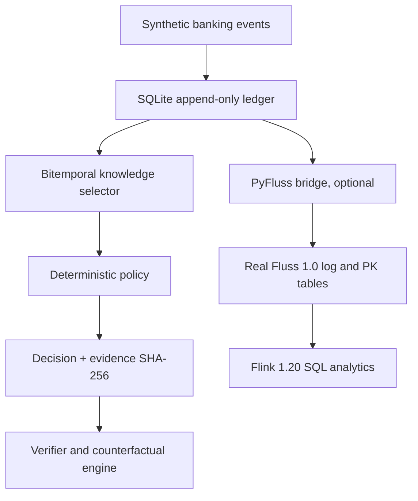

# System boundaries

**Source of truth v0.1:** Local SQLite evidence ledger.

**Live demonstration:** A native Fluss connection that appends event and
decision projections and upserts live state; PK lookups verify the actual
Fluss result. Fluss and SQLite are NOT atomically committed.

**Knowledge rule:** include an event only if both `valid_at <= decision_valid_at`
and `observed_at <= decision_knowledge_at`. Filter before policy evaluation.

**Causal rule:** if an included event references an unavailable parent, strict
mode refuses the decision; permissive mode records it but verification fails.

**Integrity rule:** canonical JSON -> SHA-256 per event; decision manifests
hold hashes and local sequence highs; decision hash covers full record. In
addition, the SQLite schema blocks regular UPDATE/DELETE statements.

**Security:** This is a nonproduction lab; replace SQLite controls, API auth,
and Fluss unsecured network settings before handling protected information.
